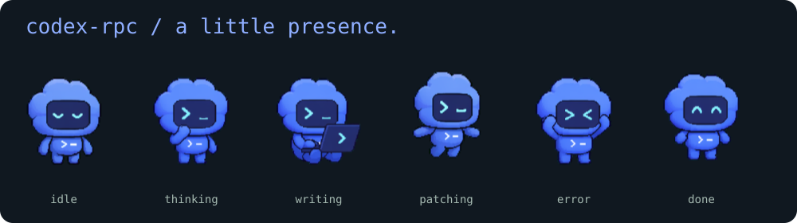
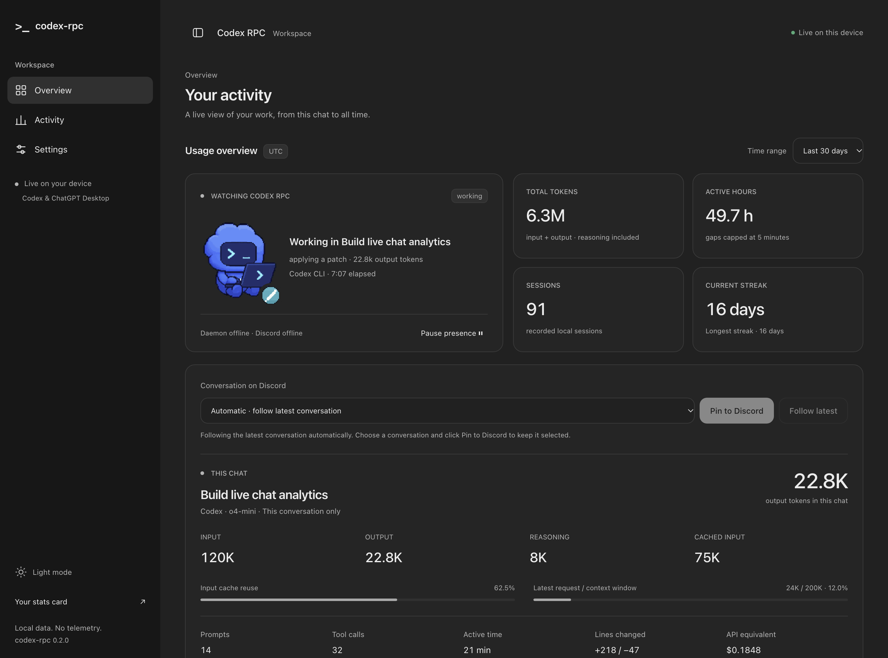

<div align="center">



**Discord Rich Presence for Codex CLI & ChatGPT Desktop.**<br/>
Live model. Little pet. Lifetime stats. Everything local.

[MIT](LICENSE) · Node 18+ · zero runtime dependencies · [security](SECURITY.md)

</div>

---

## install

```sh
npx codex-rpc@latest setup
```

That is the release install command. This source checkout is **not published to npm** by this project yet; use the verified source path until a release exists:

```sh
npm install
npm link
codex-rpc setup
codex-rpc serve
```

Setup copies a stable runtime into `~/.codex-rpc/runtime/`, registers the user-level Codex `notify` command, enables lightweight ChatGPT detection, installs login autostart, and starts the daemon. Existing notifiers are preserved; setup explains how to use the wrapper instead. No administrator access required. `setup --no-service --no-start` writes only integration files.

Open **http://localhost:47474**. The default application is `1565535814308470814` and the four GIFs plus badge are hosted directly in [this GitHub repository](https://github.com/alphasayshello/codex-rpc/tree/main/assets/pet). No asset upload is needed once these commits are pushed. Use **Settings → Discord / Codex Pet Assets** to supply your own application, HTTPS GIF URLs, or uploaded Discord asset keys.

Discord **Desktop** must be running. Browser-only Discord cannot expose its local IPC socket. Discord controls whether remote GIFs animate; uploaded application art may be static. All four actual animated GIFs ship in this repository.

## three small pieces

```text
                       01. hook
Codex notify / wrapper ───┐
Codex session log tail ───┼──→ state.json ──→ 02. daemon ──→ Discord IPC
ChatGPT process/window ──┘                       ↑
                                                  │
~/.codex/sessions/**/*.jsonl ──→ 03. scanner ──→ aggregate.json
                                  │                    │
                           scanner-cache.json     TUI · web · cards
```

**01. hook** — a short-lived JSON reader. Accepts stdin or the notify JSON argument, normalizes lifecycle events, atomically replaces state, exits. No network work in the hook. “Zero blocking delay” means no sleeps or network waits; reading/writing local files still takes time.

**02. daemon** — a small, long-lived Node process. Tails modified session logs, polls ChatGPT process/window state, watches JSON files, and sends raw Discord IPC frames. Fragmented frames, READY handshakes, ACKs, ping/pong, reconnect backoff with jitter, and 5 MiB log rotation are handled locally. Updates are coalesced with a minimum 15-second interval to avoid Discord throttling. Disabled presence clears immediately.

**03. scanner** — a short-lived child. Recursively discovers JSONL session logs and only parses files whose size or modification time changed. A modified file is re-read in full so cumulative token counters, rewrites, and truncated tails remain correct. Deleted files leave the aggregate. `history.jsonl` is a prompt-only fallback when session logs are absent, so overlapping history never doubles totals.

## the pet has a job

| state | preview | when |
| --- | --- | --- |
| working |  | tool execution, shell, editing, active goal work |
| thinking |  | task start, user prompt, reasoning |
| waiting |  | turn complete, approval event, foreground ChatGPT |
| idle |  | session end, timeout, backgrounded/closed ChatGPT |

The **actual blue Codex companion**, reused from OpenAI’s official [Codex pet sprite sheet](https://cdn.openai.com/c6d7b0d0-3abf-40b5-9d0c-ecd2b9364692/codex-spritesheet-v4.webp), not a newly drawn mascot. `npm run assets` extracts existing animation rows using Node built-ins: laptop work → working, pondering → thinking, waving → waiting, calm blink → idle. No new typing sparks, question bubbles, or sleep effects are invented. The looping GIFs use the original 192×208 frame geometry; PNG and embedded-PNG SVG previews retain the original RGBA pixels. Source hashes and row mappings are in [manifest.json](assets/pet/manifest.json); attribution is in [THIRD_PARTY_NOTICES.md](THIRD_PARTY_NOTICES.md).


## what is observable

Codex's documented [`notify`](https://learn.chatgpt.com/docs/config-file/config-advanced#notifications) fires `agent-turn-complete` with a JSON **argument**. It is not a full lifecycle hook stream. We map it to waiting, use the wrapper for session boundaries, and tail local Codex logs for task starts, reasoning, tool calls, and completion. Unknown schemas are ignored safely. Approval/waiting is exact only when the producer actually emits an approval event; no screen scraping or invented approvals.

```sh
codex-rpc run --                  # interactive Codex, plus start/end events
codex-rpc run -- exec 'fix tests' # passes args directly to codex
printf '%s\n' '{"type":"approval-request"}' | codex-rpc hook
```

If your existing `notify` must be retained, chain `node /absolute/path/to/codex-rpc/src/hook.js "$1"` in your own notifier, or use the wrapper and log tailer. Hook adapters can emit `working`, `thinking`, `waiting`, `idle`, `turn-start`, `tool-start`, `tool-end`, `approval-request`, `agent-turn-complete`, or `session-end`. Include `source: "chatgpt"` to identify a ChatGPT producer.

ChatGPT detection is process-only on Windows; macOS uses System Events for foreground detection (OS privacy permission may be needed), Linux optionally uses `xdotool` on X11. When foreground is unavailable, a running app is shown as waiting. Detection does **not** read chats, infer model reasoning, or access private ChatGPT databases. ChatGPT foreground intervals and observed process starts are accumulated locally from installation onward. Unknown foreground never adds focus hours. Token/prompt/tool analytics require a compatible JSONL producer; process detection cannot recover past chats or past token usage. Work with Apps is represented as app activity, not an undocumented pairing API.

## commands

| command | does |
| --- | --- |
| `setup` | stable runtime, Codex notify, detector, login service, daemon |
| `start` / `stop` / `restart` | manage the daemon |
| `status [--watch]` | live state, ASCII pet, totals, heatmap and rankings |
| `usage [--watch]` | heat-graded bars, 52-week heatmap, hour histogram, tools, languages, cost |
| `insights` | trend, peak weekday, hotspot, cost/token pace, streak |
| `serve [--port 47474]` | dark dashboard, SSE, range filters, interactive year heatmap |
| `statcards [--output ./statcards]` | SVG card with embedded pet, 12-month heatmap, four badges, Markdown |
| `doctor` | Node, notify, detector, daemon, real Discord handshake, aggregate age, privacy |
| `pause` / `resume` | persist `enabled: false` / `true`; kill switch for new collection and presence |
| `scan` | update the aggregate immediately |
| `hook [JSON]` | ingest argument or newline-delimited stdin JSON |
| `run -- [Codex args]` | wrap Codex with lifecycle boundaries |
| `uninstall` | remove hook block, service, runtime; retain analytics/config |
| `completion install [shell]` | install bash/zsh/fish/PowerShell completion and a managed profile block |
| `completion <shell>` | print completion script |
| `help` / `version` | reference / version |

No subscription quota requests or credential reads. `usage` means recorded local activity, not account limits.

## on your machine

Dashboard range: **7d · 30d · 90d · 1y · all**. The year heatmap stays year-wide; headline totals, languages, tools, costs, source breakdown and hour chart follow the range. UTC dates keep the CLI, cards, and scanner consistent.



Seven settings tabs: **Presence · Discord · Codex Pet Assets · Timing · Daemon Controls · Privacy · Stats**. Save locally, no cloud account. The daemon controls start, pause, resume, restart and stop the background process. The dashboard itself remains open after stop.

Local SVG endpoints update from the latest aggregate on every request:

```text
/cards/stats.svg       /cards/heatmap.svg
/cards/tokens.svg      /cards/sessions.svg
/cards/hours.svg       /cards/streak.svg
```

`statcards` exports snapshot files plus a README. `serve` provides live **local** URLs; GitHub cannot fetch your localhost. To share cards, commit exported SVGs or host them yourself. This project never publishes analytics automatically.

Optional Electron shell:

```sh
cd electron
npm install
npm start
```

Electron runs the same loopback dashboard on a random port with Node integration off, context isolation and sandboxing on. The normal CLI has no Electron dependency.

## settings & privacy

`~/.codex-rpc/config.json` contains overrides. See [config.example.json](config.example.json). Default privacy is `private`: Discord receives “a private project”, not project/file names. Tokens, model, tool name, hours and streak can still be shared. Public buttons and URLs are explicit user configuration.

```json
{
  "enabled": true,
  "privacy": "private",
  "clientId": "YOUR_DISCORD_APPLICATION_ID",
  "assets": {
    "working": "https://your-host/codex-pet-working.gif",
    "thinking": "https://your-host/codex-pet-thinking.gif",
    "waiting": "https://your-host/codex-pet-waiting.gif",
    "idle": "https://your-host/codex-pet-idle.gif",
    "badge": "https://your-host/codex-badge.png"
  },
  "buttons": [{ "label": "View GitHub", "url": "https://github.com/you/repo" }]
}
```

`enabled: false` stops new hooks, log tailing, scans and presence. It does not erase existing data. Config changes take effect without daemon restart. Use `CODEX_RPC_HOME` and `CODEX_HOME` to isolate state/input roots; `CODEX_RPC_IPC` selects a bridged socket; `CODEX_RPC_CODEX_BIN` overrides the wrapped Codex executable.

State and cache files are inspectable JSON (0700 directory, 0600 files on POSIX). `codex-state.json` and `chatgpt-state.json` retain per-source snapshots. `state.json` is the selected live activity. `aggregate.json` holds totals and daily slices. `desktop-aggregate.json` stores observed ChatGPT focus/session summaries, and `chatgpt-observation.json` stores the last process observation. `scanner-cache.json` holds per-file summaries, file paths and metadata, never raw transcript content. Even in private mode, this local cache can contain hotspot paths; privacy redaction applies to presence and aggregate views. See [SECURITY.md](SECURITY.md) for the full model.

macOS installs `~/Library/LaunchAgents/dev.codex-rpc.plist`. Linux installs `~/.config/systemd/user/codex-rpc.service`. Windows installs a per-user Startup `.cmd` task; no elevation or machine-wide service. On Linux without a user systemd session, setup prints a registration hint and still starts a detached daemon. WSL requires Discord in the same environment or an explicit trusted Unix socket bridge via `CODEX_RPC_IPC`; Windows named pipes are not directly available to Linux Node.

## counting things honestly

Input, output, cached-input and reasoning tokens are separate. Total tokens are input + output; reasoning is already part of output. New `token_usage_record` entries are preferred and deduplicated by response ID; legacy cumulative token-count records are differenced only when those records are absent. Reasoning and cost are never counted through both streams. Tool call IDs and paired user-message records are deduplicated within each log. Active time sums timestamp gaps capped at five minutes, an approximation of engaged time. Missing timestamps are marked unknown, not assigned fake dates. File languages and line churn are derived only from logged tool arguments/patches, not a whole-repository Git diff. Session-log copies outside the sessions tree are not scanned. Hotspot counts mean tool touches, not unique changed files.

Prices are **USD API-equivalent estimates**, not a ChatGPT/Codex subscription bill. Rates are snapshots, not fetched at runtime. Unknown models accumulate `unknownCostTokens` and contribute no invented cost. Historical models are retained for old sessions. Source rates checked 2026-10-29: [o3](https://developers.openai.com/api/docs/models/o3), [o4-mini](https://developers.openai.com/api/docs/models/o4-mini), [GPT-5](https://developers.openai.com/api/docs/models/gpt-5), [codex-mini-latest](https://developers.openai.com/api/docs/models/codex-mini-latest), [current pricing](https://developers.openai.com/api/docs/pricing). Update the inspectable table in `src/pricing.js` when prices change.

## build & verify

```sh
npm run assets
npm run check
npm test
npm pack --dry-run
npm run build:sea
```

Normal runtime: Node 18+. SEA build: an official Node 25.5+ binary with SEA enabled (some Homebrew builds disable it). The self-contained executable embeds the source, web UI and pet assets, then extracts a versioned local runtime on first launch. Build output: `dist/codex-rpc` (`.exe` on Windows). The current platform's executable is built locally; cross-platform binaries require builds on those platforms. No bundler, runtime SDK or native addon.

Tests use isolated temporary homes and a real local fake Discord IPC server, so testing never installs services or alters your Codex settings. CI covers Node 18/22/26 on macOS/Linux/Windows; platform services are tested as descriptors, not installed into CI users' login sessions. See [verification notes](docs/VERIFICATION.md).

## project

```text
bin/codex-rpc.js       CLI entry
src/hook.js           01. event hook
src/daemon.js         02. Discord supervisor
src/scanner.js        03. incremental history scanner
src/ipc.js            raw Discord IPC client
src/log-watcher.js    live JSONL tailer
src/chatgpt-detector.js
src/pricing.js        token cost snapshots
src/tui.js            terminal views / insights
src/server.js         loopback HTTP + SSE
src/statcards.js      local SVG exports
src/doctor.js         diagnostics
src/service.js        setup / login services
src/completion.js     four shells
src/assets/           deterministic GIF generator
assets/pet/           generated GIFs + SVG previews
web/                  dependency-free dashboard
electron/             optional desktop shell
test/                 node --test suites
scripts/              syntax / SEA builds
```

Modeled on [rar-file/claude-rpc](https://github.com/rar-file/claude-rpc), inspected at `fa3798d0e18830106fc923f0a4c4d10dd400e0b4`. Same three-piece JSON glue, command conventions and compact developer-first presentation; independent implementation adapted to Codex. No upstream telemetry, community publishing, authentication or Claude-specific integrations. Unaffiliated with OpenAI or Discord.
