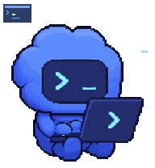
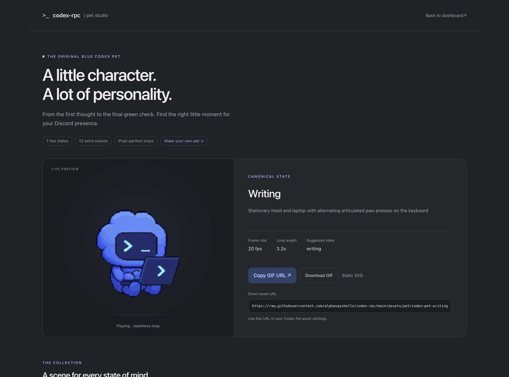
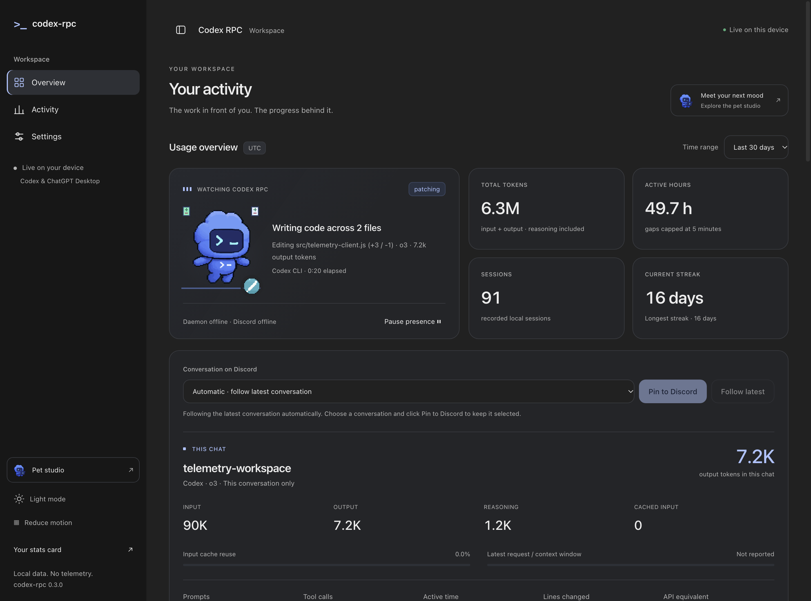

<div align="center">


# codex-rpc

**Your chat. Your tools. Your little pet.**

Discord Rich Presence and local analytics for Codex, with lightweight ChatGPT Desktop detection.

[Download latest](https://github.com/alphasayshello/codex-rpc/releases/latest) · [Release notes](docs/RELEASE-NOTES-v0.3.0.md) · [MIT](LICENSE) · [Security](SECURITY.md)

Node 18+ · zero runtime dependencies · no accounts · no telemetry

</div>

## install

Keep **Discord Desktop** running. Browser-only Discord does not expose the local IPC connection.

Install from the **latest GitHub release** with Node 18+:

```sh
npm install -g https://github.com/alphasayshello/codex-rpc/releases/latest/download/codex-rpc.tgz
codex-rpc setup
codex-rpc serve
```

Open **http://localhost:47474**. The Discord application ID and pet URLs are built in.

If no release is published yet, install from source:

```sh
git clone https://github.com/alphasayshello/codex-rpc.git
cd codex-rpc
npm ci
npm link
codex-rpc setup
codex-rpc serve
```

Standalone binaries, when attached to a release, bundle Node. Download the file matching your OS and architecture, check its SHA-256 checksum, and run it with `setup`. On macOS/Linux, mark it executable first with `chmod +x <filename>`.

**GitHub downloads only:** the npm name `codex-rpc` belongs to another project. Do not use `npx codex-rpc@latest` for this repository.

`setup` installs a stable local runtime, registers Codex notify, enables app detection, installs per-user login startup, and starts the daemon. Existing notifiers and custom asset URLs are preserved. Use `setup --no-service` to skip login startup, or `setup --no-service --no-start` to prepare the integration without starting it.

## on Discord

```text
Watching Codex RPC
Writing code across 2 files
Editing src/client.js (+42 / -12) · o4-mini · 22.8k output tokens
```

The card follows the selected conversation: edited files, logged line changes, safe command summaries, model, **output tokens for that chat**, and an elapsed timer. Input and cached tokens never inflate its output counter. Reasoning is already included in output.

Thinking shows `Pondering solution... (Elapsed: 1:05)`. Shell work shows `Running: npm test`. Idle shows the workspace and Git branch when available. Missing metadata falls back to project/model status. There are no Discord card buttons.

**Presence settings** let you choose operation or session timing and switch between live telemetry, Claude-style, cost, and compact output-token layouts. `codex-rpc preview` prints the exact card text and image URLs before you share anything.

## a pet for every state

| State | Preview | What it does |
| --- | --- | --- |
| Writing |  | Alternating paw presses; head, body and laptop stay still. |
| Thinking |  | A gentle pace, orbiting planning pixels and a steady thoughtful expression. |
| Patching |  | Focused movement and sliding plus/minus file cards. |
| Error |  | Smoke, an alert and the original panic expression. |
| Done |  | A short celebration, then idle. |
| Idle |  | Sleeping, breathing and floating Z pixels. |
| Waiting |  | A separate attention pose with bobbing speech-bubble dots. |

The mascot is the **original blue Codex Pet**, composed from its existing sprite artwork. All 19 scenes run at 20 fps with periodic motion and a consistent expression within each scene. Static previews and animated pixel badges ship too. Legacy `working` remains an alias for `writing`.

**Twelve extra scenes:** reading, searching, terminal, testing, building, installing, reviewing, debugging, connecting, focus, celebrating and cozy idle.

<table>
<tr><td align="center"><br>Reading</td><td align="center"><br>Terminal</td><td align="center"><br>Testing</td><td align="center"><br>Cozy idle</td></tr>
</table>

Real tool metadata selects reading, searching, terminal, testing, building, installing and reviewing automatically. Missing metadata keeps the normal writing scene. Extra decorative scenes are available as asset overrides; the daemon never invents activity or cycles them at random.

Open **Pet studio** in the dashboard for a larger preview, search, category filters, dark/light/checkerboard backgrounds, GIF/SVG downloads and copyable hosted URLs. In **Settings → Codex Pet Assets**, choose a target state and click a thumbnail to change its art, then **Save changes**. Automatic scene selection continues to follow your tools. The studio is also available at `/assets/pet/animation-gallery.html`.

**Make your own pet.** Pet Studio includes an editable character brief and a one-pass ChatGPT image prompt with the exact 1536 × 1872 transparent PNG sheet, 8 × 9 grid, pose map and typing alignment requirements. Copy it into ChatGPT with your character reference and the downloadable layout guide. Generated sheets require manual validation and integration; the studio does not automatically replace the bundled artwork. [Format guide](docs/PET-STUDIO.md). **Reduce motion** freezes bundled artwork and disables effects; OS reduced-motion preferences are respected. Live updates preserve animations already playing.



Artwork provenance and composition details: [asset manifest](assets/pet/manifest.json) · [third-party notices](THIRD_PARTY_NOTICES.md).

## your local workspace



- **Pin a chat to Discord.** Choose a conversation and press **Pin to Discord**. Other chats cannot steal the card; **Follow latest** restores automatic selection.
- **Inspect tool activity.** A live timeline shows running durations, completed calls, failures and exit codes—without raw arguments or output.
- **Review each turn.** Recaps show output-token deltas, observed tool calls, elapsed time and outcomes. Missing baselines stay unknown.
- **Explore lifetime usage.** Tokens, sessions, active hours, streaks, languages, tools, hotspots, hourly patterns and estimated cost.
- **Choose a range.** 7d, 30d, 90d, 1y or all time. The current-chat panel stays independent of the history range.
- **Make it yours.** Dark/light themes, mobile navigation, keyboard-accessible settings and seven settings tabs. A visual picker offers 19 pet scenes, with pixel badges and a dedicated preview studio.

The dashboard binds to loopback only and updates over SSE. Optional Electron wraps the same dashboard with Node integration disabled:

```sh
cd electron
npm ci
npm start
```

Electron is optional and is not part of the normal CLI runtime.

## commands

| Command | Purpose |
| --- | --- |
| `setup` | Install hooks, local runtime, detector and login startup; start daemon. |
| `start` / `stop` / `restart` | Manage the background daemon. |
| `status [--watch]` | Daemon/Discord status, current chat and lifetime totals. |
| `chat [--json] [--watch]` | Current-chat usage, tools, cost and context. |
| `usage [--watch]` | Heatmap, usage bars, hourly activity, tools and languages. |
| `insights` | Weekly trends, hotspots, pace and streak context. |
| `preview [--all]` | Exact card text and asset URLs; `--all` includes all 19 scenes. |
| `serve [--port 47474]` | Local dashboard and settings. |
| `statcards [--output ./statcards]` | SVG stats card, year heatmap, badges and Markdown. |
| `doctor` | Check Node, hooks, detector, daemon, Discord IPC, freshness and privacy. |
| `pause` / `resume` | Stop or resume presence and new collection. |
| `scan` | Refresh lifetime and per-chat history. |
| `run -- [Codex args]` | Wrap Codex with session lifecycle events. |
| `hook [JSON]` | Ingest an event argument or newline-delimited stdin JSON. |
| `completion install [shell]` | Install bash, zsh, fish or PowerShell completion. |
| `completion <shell>` | Print a completion script. |
| `uninstall` | Remove integration and runtime; retain config and analytics. |
| `help` / `version` | Command reference and installed version. |

Live SVG endpoints: `/cards/stats.svg`, `/cards/heatmap.svg`, and `/cards/{tokens,sessions,hours,streak}.svg`. GitHub cannot fetch localhost; export cards with `statcards` and host or commit them yourself.

## three small pieces

```text
01. hook       lifecycle events + log tail → state.json
02. daemon     selected state → raw Discord IPC
03. scanner    changed Codex JSONL files → sessions.json + aggregate.json
                                            ↓
                                     CLI · dashboard · cards
```

Inspect the JSON under `~/.codex-rpc/`. No runtime SDK, database service or cloud account.

The hook retains metadata, not transcripts. The scanner reparses changed files and reuses unchanged summaries. The daemon reconnects with backoff, rotates logs, and coalesces counters at a steady interval of at least 15 seconds. A bounded reserve allows major transitions when budget is available. Directory-watch failures fall back to polling and recover after directory recreation.

## settings and privacy

Settings live in `~/.codex-rpc/config.json`; see [the full example](config.example.json).

**Private is the default.** Project/chat names, filenames, branches and command summaries are redacted. Model and usage counters can still be shared. Public mode uses the actual conversation name, not your latest message. Full prompts, raw commands, stdout and error bodies are not stored in presence or timeline metadata.

```json
{
  "privacy": "private",
  "presence": {
    "stats": "telemetry",
    "timer": "operation",
    "showTask": true,
    "showChurn": true
  }
}
```

`enabled: false` stops new collection and clears presence without deleting history. Local scanner caches may contain paths; hashed filenames are not encryption. Read [SECURITY.md](SECURITY.md) for the complete local-data model.

Use `CODEX_RPC_HOME` for an alternate state directory and `CODEX_HOME` for an alternate Codex log root. `CODEX_RPC_IPC` selects a trusted socket bridge; `CODEX_RPC_CODEX_BIN` selects the wrapped Codex executable.

### Custom Discord images

The default application ID is `1565535814308470814`. To use your own, create an app in the [Discord Developer Portal](https://discord.com/developers/applications) and enter its **Application ID** in settings. No bot token or client secret is needed.

For each state, enter an uploaded Discord asset key (`anim_typing_large`) or a direct public HTTPS GIF URL. A custom badge overrides automatic tool badges. Uploaded application art may be static; Discord controls animation, proxying and caching. Setup refreshes old bundled URLs while preserving custom hosts. The smoother assets use a new URL version to avoid stale cached images.

### Windows

Background process checks, scanners and daemon launches suppress console windows. To upgrade an older installation that flashes blank terminals, run the updated `codex-rpc setup` once. It refreshes the installed runtime and migrates recognizable Startup `.cmd` launchers to a hidden `.vbs` launcher; custom launchers are preserved.

Login startup requires Windows Script Host/VBScript. Setup checks it and reports a fix hint without changing execution policy. Manual `codex-rpc start` is available without login autostart. Native Windows CI includes a hidden-console probe; a fresh sign-in remains a useful machine-specific check.

macOS uses a per-user LaunchAgent; Linux uses `systemd --user`. WSL needs Discord in the same environment or a trusted IPC bridge; Linux Node cannot directly use Windows named pipes.

## what the numbers mean

Codex notify provides turn-complete events; the log tailer supplies richer lifecycle data when present. File/diff counts come from logged tools and static wrapper literals, not arbitrary JavaScript execution or a whole-workspace diff. Unknown, incomplete and binary changes remain unknown.

ChatGPT Desktop detection observes the process and available foreground state. It does **not** read ChatGPT conversations or recover hidden model/token history. Tokens and tools require compatible local logs. Windows detection is process-only; macOS foreground detection may need permission, and Linux can use optional X11 tooling.

Chat usage never borrows lifetime counters. Reasoning is part of output; cached input is part of input. Active hours approximate engagement using capped event gaps. Prices are **API-equivalent estimates, not subscription bills**. The extended model table includes owner-supplied, unverified rates; unknown models remain unpriced.

## build and release

```sh
npm ci
npm run assets
npm run check
npm test
npm run release:prepare
```

For a standalone executable, use an official SEA-enabled Node 26:

```sh
npm run release:prepare -- --sea
```

Normal runtime supports Node 18+. Some Homebrew Node builds disable SEA; standalone builds need an official SEA-enabled build. Output goes to `dist/release/<platform>-<arch>/`, with versioned archives, the stable `codex-rpc.tgz` alias, release notes and checksums. Native executables must be built on each target platform.

[Release checklist](docs/RELEASE.md) · [Paste-ready v0.3.0 notes](docs/RELEASE-NOTES-v0.3.0.md) · [Verification](docs/VERIFICATION.md) · [Versioning](VERSIONING.md)

Inspired by [rar-file/claude-rpc](https://github.com/rar-file/claude-rpc): three small Node pieces joined by JSON, adapted independently for Codex. Unaffiliated with OpenAI or Discord. Original project code is MIT; bundled OpenAI artwork has separate provenance.
