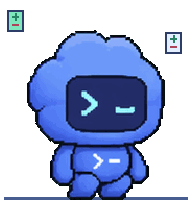

<div align="center">


**Discord Rich Presence for Codex CLI & ChatGPT Desktop.**<br/>
Your chat. Your tools. Your little pet. Everything local.

[MIT](LICENSE) · Node 18+ · zero runtime dependencies · [security](SECURITY.md)

</div>

---

## install

This project releases through **GitHub downloads**. The npm name `codex-rpc` belongs to an unrelated project; do not install this repository with `npx codex-rpc@latest`.

From source, available now:

```sh
git clone https://github.com/alphasayshello/codex-rpc.git
cd codex-rpc
npm ci
npm link
codex-rpc setup
codex-rpc serve
```

After **v0.2.0** is published, install its archive with Node 18+:

```sh
npm install -g https://github.com/alphasayshello/codex-rpc/releases/download/v0.2.0/codex-rpc-0.2.0.tgz
codex-rpc setup
```

Native downloads and checksums are prepared by the release workflow. See [release instructions](docs/RELEASE.md); no GitHub release or registry package is published automatically.

Setup refreshes running code and old bundled asset URLs while preserving custom URLs. It copies a stable runtime into `~/.codex-rpc/runtime/`, registers the user-level Codex `notify` command, enables lightweight ChatGPT detection, installs login autostart, and starts the daemon. Existing notifiers are preserved; setup explains how to use the wrapper instead. No administrator access required. `setup --no-service --no-start` writes only integration files.

Open **http://localhost:47474**. The default application is `1565535814308470814` and the six state GIFs plus tool badges are hosted directly in [this GitHub repository](https://github.com/alphasayshello/codex-rpc/tree/main/assets/pet). No asset upload is needed once these commits are pushed. Use **Settings → Discord / Codex Pet Assets** to supply your own application, HTTPS GIF URLs, or uploaded Discord asset keys.

Discord **Desktop** must be running. Browser-only Discord cannot expose its local IPC socket. Discord controls whether remote GIFs animate; uploaded application art may be static. All six state GIFs ship in this repository.

## on Discord

```text
Watching Codex RPC
Working in Codex RPC
Bash · 22.8k output tokens
▣ 0:58 elapsed
```

The default **Live telemetry** card uses the selected chat’s output tokens, edited files, logged diff counts, safe command summary and operation timer. Example:

```text
Watching Codex RPC
Writing code across 2 files
Editing src/client.js (+42 / -12) · o4-mini · 22.8k output tokens
```

Thinking shows `Pondering solution... (Elapsed: 1:05)`; execution shows `Running: npm test`; idle shows the workspace and Git branch when available. Unknown diffs fall back to directory/model status. Reasoning is a subset of output and input/cache are never added to the card’s token counter. There are **no Discord card buttons**.

**Presence → Elapsed timer** chooses current operation or whole session. Legacy **Claude-style**, **Today / all-time cost**, and **Model / output tokens** layouts remain available. Public privacy mode enables names and command summaries; private mode hides them. `codex-rpc preview` prints six scenes plus approval waiting.

Six distinct **10 fps** loops retain the original blue Codex Pet: sleeping/breathing, pacing/planning, energetic laptop typing, patch stamping, smoke/panic and a smiling celebration. Motion changes body position and surrounding pixel effects rather than cycling unrelated faces. Success settles to idle after 15 seconds by default; approval keeps its own waiting pose. Main GIFs remain below 1 MB each; all movement uses integer pixel positions, nearest-neighbor rendering, and uncropped original sprite pixels.

Open `/assets/pet/animation-gallery.html` while the dashboard is running, or use **Codex Pet Assets → Preview animated pets**. Animated status badge GIFs ship alongside static PNGs. **Reduce motion** in the sidebar freezes bundled artwork and stops stepped UI effects; OS reduced motion is respected. Unrelated SSE updates preserve mascot playback.


## Discord image configuration

Use the bundled application ID, or create an application in the [Discord Developer Portal](https://discord.com/developers/applications). In **Codex Pet Assets**, set each of `idle`, `thinking`, `writing`, `patching`, `error`, and `done` to either a Discord uploaded asset key such as `anim_typing_large`, or a direct public HTTPS GIF URL. `waiting` controls approval; legacy `working` overrides still work. A custom badge URL/key overrides automatic tool badges. Never paste a bot token or client secret; the application ID is sufficient.

GitHub raw links serve bundled GIFs after these files are pushed. Asset keys depend on the selected Discord application, and uploaded application art may be static. Discord controls external image proxying, caching and animation playback. Bump a URL query version when replacing hosted GIF bytes to avoid an old cached animation. The local gallery always renders the files in your checkout.

## three small pieces

```text
                       01. hook
Codex notify / wrapper ───┐
Codex session log tail ───┼──→ state.json ──→ 02. daemon ──→ Discord IPC
ChatGPT process/window ──┘                       ↑
                                                  │
~/.codex/sessions/**/*.jsonl ──→ 03. scanner ──→ aggregate.json
                                  │              sessions.json
                           scanner-cache.json          │
                                                  TUI · web · cards
```

**01. hook** — a short-lived JSON reader. Accepts stdin or the notify JSON argument, normalizes lifecycle events, atomically replaces state, exits. No network work in the hook. “Zero blocking delay” means no artificial sleeps or network waits on the normal hook path; reading/writing local files still takes time. Windows transient file-handle conflicts receive a bounded retry (up to 71 ms total) to preserve atomic writes; normal writes do not wait.

**02. daemon** — a small, long-lived Node process. Tails modified session logs, polls ChatGPT process/window state, watches JSON files, and sends raw Discord IPC frames. Fragmented frames, READY handshakes, ACKs, ping/pong, reconnect backoff with jitter, and 5 MiB log rotation are handled locally. Counter updates are coalesced at a steady interval of at least 15 seconds. A bounded two-slot reserve allows major transitions promptly when budget is available; repeated transitions cannot bypass the budget. Failed sends are retried without marking them acknowledged. Disabled presence clears immediately.

**03. scanner** — a short-lived child. Recursively discovers JSONL session logs and only parses files whose size or modification time changed. A modified file is re-read in full so cumulative token counters, rewrites, and truncated tails remain correct. Deleted files leave both the aggregate and per-chat index. `sessions.json` keeps each conversation’s own usage, tools and costs, keyed by its actual session ID. `history.jsonl` is a prompt-only fallback when session logs are absent, so overlapping history never doubles totals.

## the pet has a job

| state | preview | when |
| --- | --- | --- |
| writing |  | writing/generation, bash and tool execution |
| thinking |  | reasoning and planning |
| patching |  | file edits and diff application |
| error |  | failed tools, error/stuck events |
| done |  | brief success loop before idle |
| idle |  | inactivity, session end, background app |
| waiting |  | approval/foreground app with no telemetry |

The **actual blue Codex companion** comes from OpenAI’s official [sprite sheet](https://cdn.openai.com/c6d7b0d0-3abf-40b5-9d0c-ecd2b9364692/codex-spritesheet-v4.webp). The Node-only pipeline composites original poses with integer motion and original code-generated pixel effects. Source PNG/SVG previews retain original RGBA; the GIF encoder quantizes colors. `working` remains a compatibility alias for `writing`. Source hashes, frame mappings, motion and effect provenance are in [manifest.json](assets/pet/manifest.json); artwork attribution is in [THIRD_PARTY_NOTICES.md](THIRD_PARTY_NOTICES.md).


## what is observable

The pure `src/watcher.js` parser extracts safe file paths, multi-file patches and exact logged +/- line counts without retaining code. It recognizes direct tools and bounded static literals inside `functions.exec` wrappers; dynamic expressions are not evaluated. Public command summaries retain only allowlisted executable/subcommand names (`npm test`, `git diff`), never flags, secrets or operands. Git branch lookup reads `.git/HEAD` and worktree pointers locally without spawning `git`. No changes or unparsable/binary/deleted unknown diffs remain unknown, not fabricated zeros.


Codex's documented [`notify`](https://learn.chatgpt.com/docs/config-file/config-advanced#notifications) fires `agent-turn-complete` with a JSON **argument**. It is not a full lifecycle hook stream. We map it to waiting, use the wrapper for session boundaries, and tail local Codex logs for task starts, reasoning, tool calls, and completion. Unknown schemas are ignored safely. Approval/waiting is exact only when the producer actually emits an approval event; no screen scraping or invented approvals.

```sh
codex-rpc run --                  # interactive Codex, plus start/end events
codex-rpc run -- exec 'fix tests' # passes args directly to codex
printf '%s\n' '{"type":"approval-request"}' | codex-rpc hook
```

If your existing `notify` must be retained, chain `node /absolute/path/to/codex-rpc/src/hook.js "$1"` in your own notifier, or use the wrapper and log tailer. Hook adapters can emit `working`, `thinking`, `waiting`, `idle`, `turn-start`, `tool-start`, `tool-end`, `approval-request`, `agent-turn-complete`, or `session-end`. Include `source: "chatgpt"` to identify a ChatGPT producer.

ChatGPT detection is process-only on Windows; macOS uses System Events for foreground detection (OS privacy permission may be needed), Linux optionally uses `xdotool` on X11. When foreground is unavailable, a running app is shown as waiting. Detection does **not** read chats, infer model reasoning, or access private ChatGPT databases. ChatGPT foreground intervals and observed process starts are accumulated locally from installation onward. Unknown foreground never adds focus hours. Token/prompt/tool analytics require a compatible JSONL producer; process detection cannot recover past chats or past token usage. Work with Apps is represented as app activity, not an undocumented pairing API.

## commands

| command | does |
| --- | --- |
| `setup` | stable runtime, Codex notify, detector, login service, daemon |
| `start` / `stop` / `restart` | manage the daemon |
| `status [--watch]` | live state, ASCII pet, this chat, totals, heatmap and rankings |
| `chat [--json] [--watch]` | current conversation’s tokens, tools, prompts, time and estimated cost |
| `usage [--watch]` | heat-graded bars, 52-week heatmap, hour histogram, tools, languages, cost |
| `insights` | trend, peak weekday, hotspot, cost/token pace, streak |
| `preview` | exact current Discord text and asset URLs for all four states |
| `serve [--port 47474]` | dark dashboard, SSE, range filters, interactive year heatmap |
| `statcards [--output ./statcards]` | SVG card with embedded pet, 12-month heatmap, four badges, Markdown |
| `doctor` | Node, notify, detector, daemon, real Discord handshake, aggregate age, privacy |
| `pause` / `resume` | persist `enabled: false` / `true`; kill switch for new collection and presence |
| `scan` | update lifetime and per-chat history immediately |
| `hook [JSON]` | ingest argument or newline-delimited stdin JSON |
| `run -- [Codex args]` | wrap Codex with lifecycle boundaries |
| `uninstall` | remove hook block, service, runtime; retain analytics/config |
| `completion install [shell]` | install bash/zsh/fish/PowerShell completion and a managed profile block |
| `completion <shell>` | print completion script |
| `help` / `version` | reference / version |

No subscription quota requests or credential reads. `usage` means recorded local activity, not account limits.

## on your machine

Choose a conversation in **Conversation on Discord**, then press **Pin to Discord**. Pinning persists across restarts and applies to the card, current-chat dashboard, timeline and CLI status. Other chats keep collecting data. **Follow latest** returns to automatic selection; an idle pinned chat stays idle rather than switching to another conversation.

**Turn recaps** summarize each newly observed turn: output tokens generated, reasoning as a subset, observed tool calls, elapsed time and outcome. Recaps are metadata only, capped at 20 per chat; missing baselines stay unknown rather than counting input tokens. Older turns are not retroactively invented.

The **Tool timeline** shows up to 50 recent observed calls with live durations, completed/failed/unknown outcomes, and numeric exit codes when available. It never displays arguments, stdout or raw error bodies. Older history may have fewer events or unknown outcomes.

A ChatGPT-inspired workspace with neutral dark and light themes, a collapsible sidebar, and a mobile navigation drawer. Switch appearance at the bottom of the sidebar; appearance stays in this browser. Settings support keyboard navigation and all seven categories.

The **THIS CHAT** headline counts output tokens only. Its separate breakdown follows the selected live conversation: input/output/reasoning/cached tokens, cache reuse, latest request/context window when reported, prompts, tool calls, active time, line changes and API-equivalent cost. Running and recent tools show names and recorded durations, never raw arguments. Unknown values show **—**, not a lifetime total.

Dashboard range: **7d · 30d · 90d · 1y · all**. The year heatmap stays year-wide; headline totals, languages, tools, costs, source breakdown and hour chart follow the range. UTC dates keep the CLI, cards, and scanner consistent.


The chat panel is independent of this range; switching chats switches its identity and metrics. For the same view in your terminal, run `codex-rpc chat --watch`; use `codex-rpc chat --json` for scripts.

Seven settings tabs: **Presence · Discord · Codex Pet Assets · Timing · Daemon Controls · Privacy · Stats**. Save locally, no cloud account. The daemon controls start, pause, resume, restart and stop the background process. The dashboard itself remains open after stop.

Local read-only JSON endpoints include `/api/state`, `/api/aggregate?range=30d`, **`/api/chat`**, `/api/chats`, and `/api/timeline`. The chat endpoint returns the current conversation summary, with `null` for unavailable metrics; it never substitutes all-time usage.

Local SVG endpoints update from the latest aggregate on every request:

```text
/cards/stats.svg       /cards/heatmap.svg
/cards/tokens.svg      /cards/sessions.svg
/cards/hours.svg       /cards/streak.svg
```

`statcards` exports snapshot files plus a README. `serve` provides live **local** URLs; GitHub cannot fetch your localhost. To share cards, commit exported SVGs or host them yourself. This project never publishes analytics automatically.

Optional Electron shell:

```sh
cd electron
npm install
npm start
```

Electron runs the same loopback dashboard on a random port with Node integration off, context isolation and sandboxing on. The normal CLI has no Electron dependency.

## settings & privacy

`~/.codex-rpc/config.json` contains overrides. See [config.example.json](config.example.json). Default privacy is `private`: Discord receives “a private project”, not task titles or project/file names. Public mode uses the actual conversation name from `~/.codex/session_index.jsonl`; later messages never replace it. Renames are picked up automatically. Unnamed chats fall back to the project label; full prompts are not used as display titles. Tokens, model, tool name, hours and streak can still be shared. Public buttons and URLs are explicit user configuration.

```json
{
  "enabled": true,
  "privacy": "private",
  "clientId": "1565535814308470814",
  "presence": { "stats": "chat", "showTask": true, "showChurn": true },
  "assets": {
    "working": "https://your-host/codex-pet-working.gif",
    "thinking": "https://your-host/codex-pet-thinking.gif",
    "waiting": "https://your-host/codex-pet-waiting.gif",
    "idle": "https://your-host/codex-pet-idle.gif",
    "badge": "https://your-host/codex-badge.png"
  },
  "buttons": [{ "label": "View GitHub", "url": "https://github.com/you/repo" }]
}
```

`enabled: false` stops new hooks, log tailing, scans and presence. It does not erase existing data. Config changes take effect without daemon restart. Use `CODEX_RPC_HOME` and `CODEX_HOME` to isolate state/input roots; `CODEX_RPC_IPC` selects a bridged socket; `CODEX_RPC_CODEX_BIN` overrides the wrapped Codex executable.

State and cache files are inspectable JSON (0700 directory, 0600 files on POSIX). `codex-state.json` and `chatgpt-state.json` retain per-source snapshots. `state.json` is the selected live activity. `aggregate.json` holds lifetime totals and daily slices. `sessions.json` holds the scanned per-conversation summaries. `live/` keeps source-scoped, hashed-ID chat snapshots so switching chats cannot carry another chat’s counters into the next one. `desktop-aggregate.json` stores observed ChatGPT focus/session summaries, and `chatgpt-observation.json` stores the last process observation. `scanner-cache.json` holds per-file summaries, file paths and metadata, never raw transcript content. Even in private mode, this local cache can contain hotspot paths; privacy redaction applies to presence, per-chat API/CLI views, and aggregate views. Per-chat exports redact hotspot filenames in private mode; live snapshots omit task/project/file names. Hashed snapshot filenames do not encrypt their contents. See [SECURITY.md](SECURITY.md) for the full model.

macOS installs `~/Library/LaunchAgents/dev.codex-rpc.plist`. Linux installs `~/.config/systemd/user/codex-rpc.service`. Windows installs a per-user Startup `.cmd` task; no elevation or machine-wide service. On Linux without a user systemd session, setup prints a registration hint and still starts a detached daemon. WSL requires Discord in the same environment or an explicit trusted Unix socket bridge via `CODEX_RPC_IPC`; Windows named pipes are not directly available to Linux Node.

## counting things honestly

Input, output, cached-input and reasoning tokens are separate. Total tokens are input + output; reasoning is already part of output. Within each conversation, new `token_usage_record` entries are preferred and deduplicated by response ID; legacy cumulative token-count records are differenced only when those records are absent. Reasoning and cost are never counted through both streams. Tool call IDs and paired user-message records are deduplicated within each log. Active time sums timestamp gaps capped at five minutes, an approximation of engaged time. Missing timestamps are marked unknown, not assigned fake dates. File languages and line churn are derived only from logged tool arguments/patches, not a whole-repository Git diff. Session-log copies outside the sessions tree are not scanned. Hotspot counts mean tool touches, not unique changed files.

Chat totals combine matching session-ID history and live observations without adding the same cumulative counters twice. Lifetime aggregates never fill missing chat metrics. Prompts, tools, line changes and active time need compatible local logs; live tool counts cover observed calls. ChatGPT process detection alone cannot reveal a conversation ID, title, model or token usage, so unavailable chat data stays unknown.

Prices are **USD API-equivalent estimates**, not a ChatGPT/Codex subscription bill. Rates are snapshots, not fetched at runtime. The extended model table includes owner-supplied, unverified estimates (including Daybreak and additional model tiers); these must not be treated as official quotes. Scanner caches include a pricing fingerprint so table changes recalculate historical estimates even when logs are unchanged. A missing cached-input rate uses the full input rate rather than treating tokens as free. Unknown models accumulate `unknownCostTokens` and contribute no invented cost. Historical models are retained for old sessions. Source rates checked 2026-10-29: [o3](https://developers.openai.com/api/docs/models/o3), [o4-mini](https://developers.openai.com/api/docs/models/o4-mini), [GPT-5](https://developers.openai.com/api/docs/models/gpt-5), [codex-mini-latest](https://developers.openai.com/api/docs/models/codex-mini-latest), [current pricing](https://developers.openai.com/api/docs/pricing). Update the inspectable table in `src/pricing.js` when prices change.

## build & verify

```sh
npm run assets
npm run check
npm test
npm pack --dry-run
npm run build:sea
```

Normal runtime: Node 18+. SEA build: an official Node 25.5+ binary with SEA enabled (some Homebrew builds disable it). The self-contained executable embeds the source, web UI and pet assets, then extracts a versioned local runtime on first launch. Build output: `dist/codex-rpc` (`.exe` on Windows). The current platform's executable is built locally; cross-platform binaries require builds on those platforms. No bundler, runtime SDK or native addon.

Tests use isolated temporary homes and a real local fake Discord IPC server, so testing never installs services or alters your Codex settings. CI covers Node 18/22/26 on macOS/Linux/Windows; platform services are tested as descriptors, not installed into CI users' login sessions. See [verification notes](docs/VERIFICATION.md).

## project

```text
bin/codex-rpc.js       CLI entry
src/hook.js           01. event hook
src/daemon.js         02. Discord supervisor
src/scanner.js        03. incremental history scanner
src/ipc.js            raw Discord IPC client
src/presence.js       card templates and compact usage text
src/chat.js           current-chat history/live summary
src/live.js           scoped snapshots and token normalization
src/log-watcher.js    live JSONL tailer
src/chatgpt-detector.js
src/pricing.js        token cost snapshots
src/tui.js            terminal views / insights
src/server.js         loopback HTTP + SSE
src/statcards.js      local SVG exports
src/doctor.js         diagnostics
src/service.js        setup / login services
src/completion.js     four shells
src/assets/           deterministic GIF generator
assets/pet/           generated GIFs + SVG previews
web/                  dependency-free dashboard
electron/             optional desktop shell
test/                 node --test suites
scripts/              syntax / SEA builds
```

Modeled on [rar-file/claude-rpc](https://github.com/rar-file/claude-rpc), inspected at `fa3798d0e18830106fc923f0a4c4d10dd400e0b4`. Same three-piece JSON glue, command conventions and compact developer-first presentation; independent implementation adapted to Codex. No upstream telemetry, community publishing, authentication or Claude-specific integrations. Unaffiliated with OpenAI or Discord.

## Windows console flashes

If blank terminals were opening and closing every few seconds, update this checkout and run `node bin/codex-rpc.js setup` once. That refreshes the installed runtime and restarts the daemon. Detector polling, scans and background launches now use hidden windows; setup replaces recognizable old Startup `.cmd` files with a hidden `.vbs` launcher. Custom launcher files are preserved with a warning.

Login autostart requires Windows Script Host/VBScript. Setup checks availability and reports a fix hint if your Windows installation disables it; it does not change execution policies. Manual `codex-rpc start` still supports background operation without login autostart. Microsoft is [deprecating VBScript](https://techcommunity.microsoft.com/blog/windows-itpro-blog/vbscript-deprecation-timelines-and-next-steps/4148301), so this dependency is documented rather than silently assumed.

For validation, leave the updated daemon running for at least 15 seconds, allowing several detector checks, and then test a fresh sign-in. Native Windows CI includes a console-visibility probe. macOS-only tests cannot certify your Windows desktop behavior.
